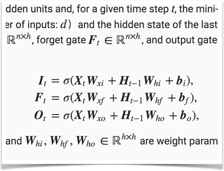
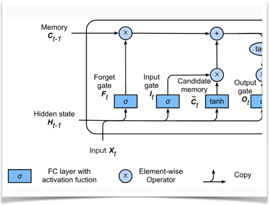
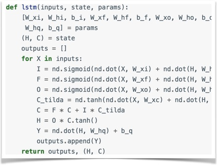
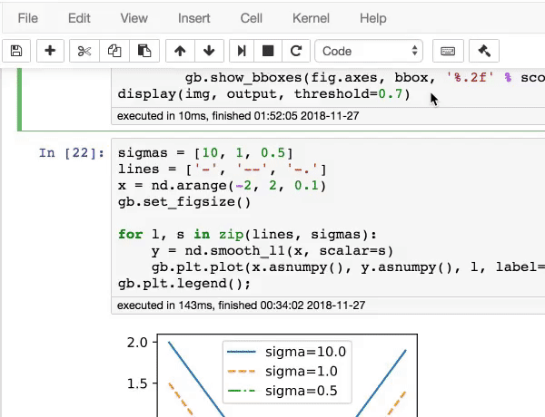

# Modified D2L.ai: Interactive Deep Learning Book with Multi-Framework Code, Math, and Discussions

  

Personal ML & Deep Learning notebook featuring theory, custom LaTeX notes, and executable PyTorch/C++ implementations. Adapted from D2L under CC-BY-SA-4.0 & MIT-0.

[Original Book website](https://d2l.ai/) 

<h5 align="center"><i>The best way to understand deep learning is learning by doing.</i></h5>

  
  
  
  

This open-source book represents our attempt to make deep learning approachable, teaching you the concepts, the context, and the code. The entire book is drafted in Jupyter notebooks, seamlessly integrating exposition figures, math, and interactive examples with self-contained code.

Our goal is to offer a resource that could
1. be freely available for everyone;
2. offer sufficient technical depth to provide a starting point on the path to actually becoming an applied machine learning scientist;
3. include runnable code, showing readers how to solve problems in practice;
4. allow for rapid updates, both by us and also by the community at large;
5. be complemented by a forum for interactive discussion of technical details and to answer questions.

